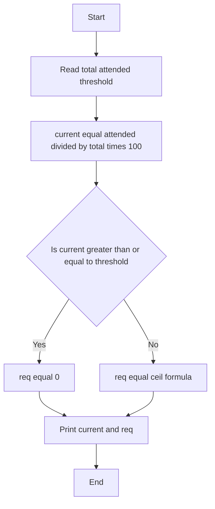

## Problem Statement
Given total classes, attended classes and threshold percentage.
Calculate current attendance = attended / total * 100.
If current >= threshold, required extra classes = 0.
Else required = ceil((threshold/100*total - attended) / (1 - threshold/100))
Print current percentage with 2 decimals and required classes.

## Algorithm
1. START
2. Read total, attended, threshold
3. current = attended / total * 100
4. IF current >= threshold THEN req = 0
5. ELSE req = ceil((threshold/100*total - attended) / (1 - threshold/100))
6. Print current with 2 decimals
7. Print req
8. END

## Flowchart


## Sample Input and Output

**Input 1:**
```
100
75
75
```

**Output 1:**
```
75.00
0
```

**Input 2:**
```
100
60
75
```

**Output 2:**
```
60.00
60
```


